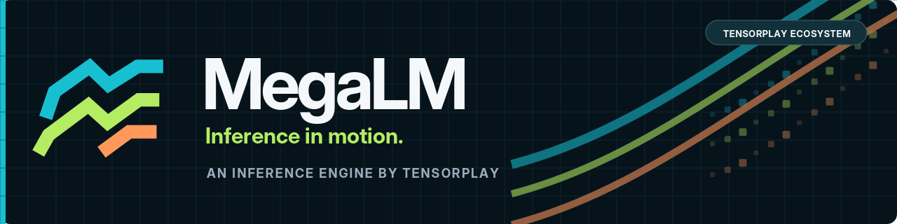
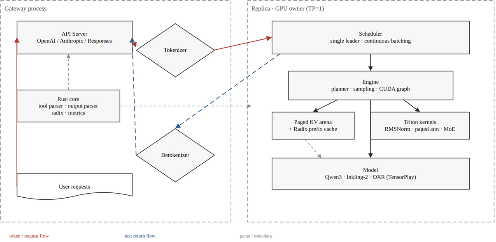
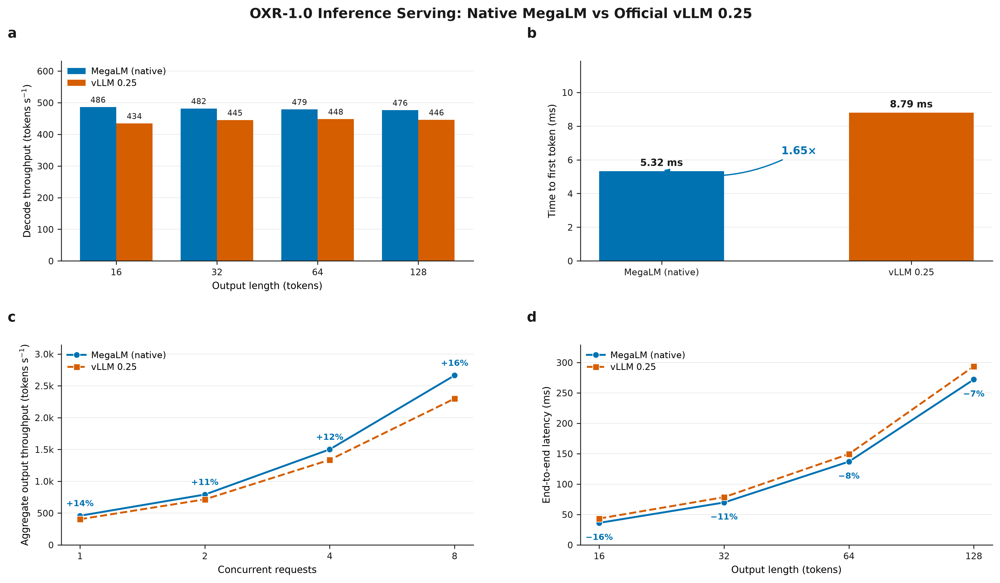
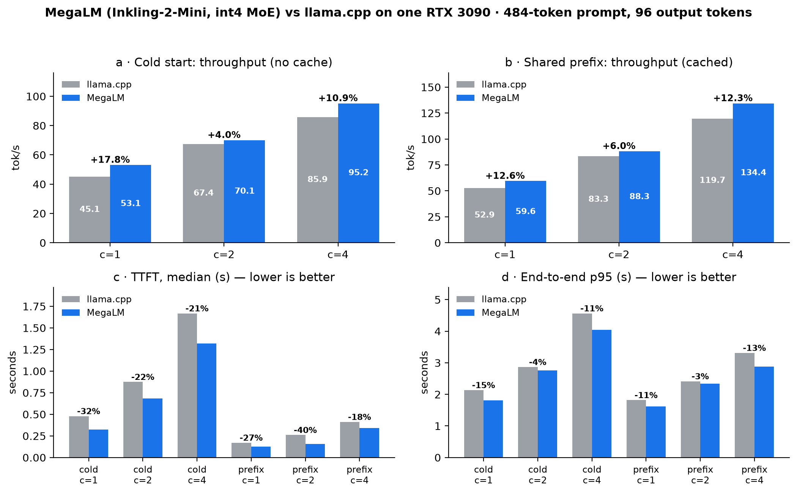
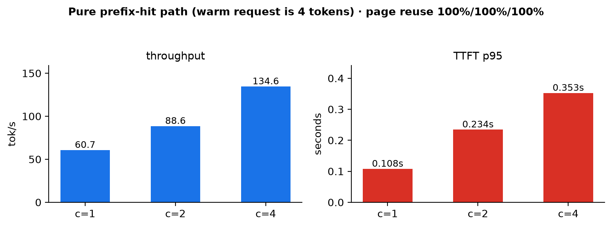

<div align="center">
  

  <p><strong>A high-performance LLM inference engine built on <a href="https://github.com/lexing-2026/TensorPlay">TensorPlay</a></strong></p>

  <p>
    <a href="#about-megalm">About</a> ·
    <a href="#-news">News</a> ·
    <a href="#-built-on-tensorplay">Built on TensorPlay</a> ·
    <a href="#-key-features">Key Features</a> ·
    <a href="#-quick-start">Quick Start</a> ·
    <a href="#-api-endpoints">API</a> ·
    <a href="#-performance">Performance</a> ·
    <a href="#-documentation">Documentation</a> ·
    <a href="./CONTRIBUTING.md">Contributing</a>
  </p>
  <p>
    <a href="./README.md"><strong>EN</strong></a> ·
    <a href="./README.zh.md"><strong>中文</strong></a>
  </p>
  <p>
    
    
    
    <a href="https://github.com/ohtensorplay/megalm/stargazers"></a>
    <a href="https://github.com/ohtensorplay/megalm/actions/workflows/lint.yml"></a>
    <a href="https://github.com/ohtensorplay/megalm/actions/workflows/test.yml"></a>
    <a href="./LICENSE"></a>
  </p>
</div>

---

## 📰 News

- **[2026/11] Native Nanbeige4.2-3B adaptation** — a 22-layer dense RoPE/GQA decoder whose full stack is replayed twice with shared weights (3B non-embedding parameters). MegaLM reuses the Llama-family TensorPlay hot path and streaming loader, adds loop scheduling with per-loop KV cache layers, and loads weights through the official Hub SDKs. \[[Model](https://huggingface.co/Nanbeige/Nanbeige4.2-3B)\] \[[Usage](docs/models/nanbeige.md)\]
- **[2026/11] Native Inkling-2 support** — MegaLM now runs `thinkingmachines/Inkling-2-Mini` end to end: a 26.4B-parameter recurrent model (3.4B active) with 24 mixed local/global attention layers, a 48-step loop, and NVFP4/MXFP8 expert weights resident during decode. The hot path stays free of Transformers. \[[Model](https://huggingface.co/thinkingmachines/Inkling-2-Mini)\] \[[Blog](https://thinkingmachines.ai/news/inkling-2-mini/)\]
- **[2026/11] Native OXR-1.0 vision-language support** — the LLM and vision tower both execute on the TensorPlay hot path, with image placeholder expansion and full visual-cache semantics. \[[Model](https://huggingface.co/SoMarkAI/OXR-1.0)\] \[[GitHub](https://github.com/SoMarkAI/OXR)\]
- **[2026/11] Head-to-head serving results** — on a single RTX 3090, native MegaLM leads official vLLM 0.25 across four serving scenarios, and leads llama.cpp on all 18 throughput/latency points with identical greedy output. \[[vs vLLM](docs/benchmarks/oxr_vllm_comparison.png)\] \[[vs llama.cpp](docs/benchmarks/llamacpp_comparison.png)\]
- **[2026/11] ModelBest MiniCPM5 adaptation** — MiniCPM5-1B/2B run on the native Llama-family hot path with explicitly declared (decoupled) `head_dim`; the family's `<function name=...><param name=...>` XML tool calls are parsed by the new `minicpm5` parser. \[[Model](https://www.modelscope.cn/models/OpenBMB/MiniCPM5-1B)\]
- **[2026/11] ModelBest MiniCPM4-0.5B adaptation** — MiniCPM4 runs on the `minicpm` family path with native LongRoPE short/long-factor interpolation, `scale_emb`/`scale_depth`/`dim_model_base` scaling, and tied embedding/lm_head weights. Greedy output matches the official implementation token for token. \[[Model](https://www.modelscope.cn/models/OpenBMB/MiniCPM4-0.5B)\]
- **[2026/11] Native LiquidAI LFM3-1.7B adaptation** — 24-layer tri-hybrid architecture (13 gated short convs, 5 sliding-window attention, 6 global attention) with QK-RMSNorm, per-head sigmoid gates, sandwich norm and managed convolution state on the paged KV path. \[[Model](https://huggingface.co/LiquidAI/LFM3-1.7B)\]

---

## About MegaLM

MegaLM is the LLM inference and serving engine of the **[TensorPlay](https://github.com/lexing-2026/TensorPlay) ecosystem**, targeting mainstream models such as Qwen3 / Qwen3.5 and designed for low-latency, high-throughput online serving.

If [TensorPlay](https://github.com/lexing-2026/TensorPlay) provides the low-level foundation for tensors, operators, and kernels, then MegaLM is the **inference and serving layer** built on top of it — applying TensorPlay's tensor runtime and kernel system to LLM inference, with a complete set of model capabilities, scheduling strategies, and serving protocols.

- ⚡ **Fast**: Custom fused operators and continuous batching, competitive for both single-request and high-concurrency workloads.
- 🪶 **Light**: Hot paths do not depend on Transformers; streaming weight loading for faster startup.
- 🧩 **Complete**: Broad open-model coverage, multimodal inputs, tool calling, structured output, and observability.
- 🔌 **Compatible**: OpenAI-compatible API that plugs into existing ecosystems and clients.

> Requirements: Linux · Python ≥ 3.12 · NVIDIA Ampere or newer GPU.

---

## 🧱 Built on TensorPlay

MegaLM and TensorPlay form a top-to-bottom technology stack:

| Layer | Project | Responsibility |
| --- | --- | --- |
| **Inference & serving** | **MegaLM** | Model execution, continuous batching, KV cache, sampling, serving gateway, and protocols |
| **Tensor & kernel foundation** | [TensorPlay](https://github.com/lexing-2026/TensorPlay) | Tensor runtime, operator dispatch, kernel system, serialization, and device abstraction |
| **Compiler backends** (optional) | [tensorplay-tensorrt](https://github.com/lexing-2026/tensorplay-tensorrt) and others | Compilation and backend acceleration for TensorPlay |



MegaLM's compute kernels and weight loading are all built on TensorPlay — from tensor operations and operator dispatch to checkpoint serialization, the entire execution stack shares one set of underlying semantics. This means:

- **One foundation, many uses**: the same TensorPlay capabilities serve both framework learning and production inference.
- **End-to-end control**: from low-level kernels to serving protocols, everything is connected within one ecosystem, reducing heterogeneous dependencies.
- **Extensible**: TensorPlay's backend and hardware ecosystem can continuously bring new acceleration possibilities to MegaLM.

---

## ✨ Key Features

### High-Performance Inference
- **Continuous batching**: decode-first, chunked prefill, and mixed prefill/decode batches, balancing time-to-first-token and overall throughput.
- **Smart caching**: real GPU paged KV and page-aligned Radix prefix cache, zero-copy reuse of shared prefixes, and automatic eviction of cold prefixes under memory pressure.
- **Hierarchical KV**: optional pinned host and filesystem tiers with content-addressed pages, async DMA, staged promotions, and scheduler-safe reuse.
- **Quantized KV cache**: FP8 (per-tensor/per-head/dynamic per-token-head), INT4 and NVFP4 schemes aligned with vLLM, with inline scales, native TensorPlay ops, dequantizing attention kernels and optional SM89+ native FP8 attention (see [`docs/design/kv-cache-quantization.md`](docs/design/kv-cache-quantization.md)).
- **Weight-only int4 (AWQ / compressed-tensors)**: `pack-quantized` W4A16 checkpoints keep their int4 codes and checkpoint scales resident and execute through TensorPlay's fused dequantizing GEMM; `Qwen3-VL-8B-Instruct-AWQ-4bit` runs end to end without a bf16 weight copy.
- **Custom operators**: fused RMSNorm, paged attention, grouped tensor-core MoE, and persistent routing, hand-optimized on TensorPlay.
- **CUDA Graph**: bucket capture/replay during decode to eliminate kernel launch overhead.
- **Multi-LoRA**: vLLM-style per-request adapters on dense generic causal LMs, with a BGMV batched-GEMV kernel, dynamic registration, and a fixed slot budget ([docs/design/lora.md](docs/design/lora.md)).
- **Optional Stax prefill lowering**: `--compile-backend stax` probes SwiGLU dense-MLP prefill regions at exact token buckets, sharing one artifact across equal-shaped layers and admitting a bucket only when native lowering, numerics, shape, speed and CUDA Graph capture all pass under startup and device-memory budgets; attention projections and vision-tower MLPs are opt-in via `--compile-regions`. On the current TensorPlay build Stax is break-even against the fused hand-written kernels, so the default gate rejects every region and decode keeps the hand-written kernels (see [`docs/design/compile-backend.md`](docs/design/compile-backend.md)).

### Broad Model Support
- Covers **Qwen3 / Qwen3.5** (Dense / MoE), **Qwen3-VL**, Llama, Mistral, Mixtral, Qwen2, Yi, DeepSeek, Phi3, InternLM, Granite, ERNIE, **MiniCPM4 / MiniCPM5**, **LFM3**, and more.
- Native support for **Qwen2.5-Omni** multimodal Thinker and the **Inkling-2** recurrent architecture.

### Complete Serving Protocols
- **OpenAI Chat Completions**: ready-to-use streaming inference endpoint.
- **Anthropic Messages** and **OpenAI Responses**: native protocol endpoints with response store and tool-call events.
- **Function Calling**: incremental tool-call parsing across model families with streaming argument output.
- **Decision model endpoints**: `/v1/systemone` and `/v1/decisions` — use any chat model as a decision model without dedicated weights.

### Production Ready
- **Structured output**: engine-level constrained decoding for `json_object` / `json_schema`, guaranteeing valid JSON.
- **Multimodal media**: image, video, and audio inputs with SSRF-protected remote URL fetching.
- **Observability**: Prometheus metrics endpoint, structured logs, and distributed tracing.
- **Context management**: automatic history trimming for stable long conversations.

---

## 🚀 Quick Start

> **Platform**: Linux with an NVIDIA Ampere or newer GPU, Python ≥ 3.12. Other platforms are not currently supported.

### 1. Environment Setup

```bash
python3.12 -m venv .venv
source .venv/bin/activate
```

### 2. Installation

```bash
python -m pip install tensorplay
python -m pip install -e .
# For repo-id loading from MegaHub / Hugging Face / ModelScope:
python -m pip install -e '.[hub]'
```

> **Docker alternative:** build with
> `docker build --build-arg PIP_EXTRA_INDEX_URL=https://download.tensorplay.cn/simple -t megalm:local .`
> and run with `docker run --gpus all -p 8000:8000 -v /path/to/models:/models:ro megalm:local /models/<model> --host 0.0.0.0`.
> See [Docker deployment](docs/deployment/docker.md).

### 3. Offline Inference

```bash
python -m megalm \
  --model <your-model> \
  --prompt "Introduce yourself in one sentence." \
  --max-new-tokens 16

# Hub repo ids are downloaded through the official SDKs before startup
python -m megalm --model Qwen/Qwen3-8B --source hf --prompt "Hello"
# mega://models/<ns>/<repo>, hf:<ns>/<repo>, ms:<ns>/<repo> also work
```

See [Model sources: MegaHub / Hugging Face / ModelScope](docs/getting_started/model-sources.md).

### 4. Launch the API Server

```bash
megalm-server --model <your-model> \
  --served-model-name <model-name> \
  --host 127.0.0.1 \
  --port 8000
```

### 5. Verify and Send a Request

Check that the server is ready:

```bash
curl http://127.0.0.1:8000/health
# {"status":"ok"}
```

Send a chat completion request (use the same name as `--served-model-name`):

```bash
curl http://127.0.0.1:8000/v1/chat/completions \
  -H "Content-Type: application/json" \
  -d '{
    "model": "<model-name>",
    "messages": [{"role": "user", "content": "Introduce yourself in one sentence."}],
    "max_tokens": 128,
    "stream": false
  }'
```

Set `"stream": true` to receive Server-Sent Events. Model and runtime information is available at `/v1/models` and `/api/inference/status`; Prometheus metrics at `/metrics`.

---

## 🔌 API Endpoints

| Endpoint | Description |
| --- | --- |
| `POST /v1/chat/completions` | OpenAI-style chat with streaming, tools, and structured output |
| `POST /v1/completions` | OpenAI-style text completions |
| `POST /v1/messages` | Anthropic Messages API (plus `/v1/messages/count_tokens`) |
| `POST /v1/responses` | OpenAI Responses API with a built-in response store |
| `POST /v1/systemone` | TypeSafe decision questions |
| `POST /v1/decisions` | SGLang-style decision questions |
| `POST /v1/load_lora_adapter` | Register a PEFT LoRA adapter at runtime |
| `POST /v1/unload_lora_adapter` | Unregister a LoRA adapter |
| `GET /v1/models` | Available model information |
| `GET /health` | Service health check |
| `GET /metrics` | Prometheus metrics |

---

## 📊 Performance

### Native MegaLM vs. official vLLM 0.25

Test configuration:

- Hardware: 1 × RTX 3090 (BF16)
- Model: OXR-1.0 (vision-language)
- Input: fixed image + prompt
- Baseline: official vLLM 0.25
- Workload: decode throughput and end-to-end latency across output lengths 16 / 32 / 64 / 128; time to first token; aggregate throughput across 1 / 2 / 4 / 8 concurrent requests



Full configuration: [`docs/benchmarks/oxr_vllm_comparison.pdf`](docs/benchmarks/oxr_vllm_comparison.pdf).

### MegaLM vs. llama.cpp — same GPU, same GGUF, same launch flags

One interleaved session on a single RTX 3090: llama.cpp is measured once before
and once after MegaLM so clock drift is bracketed, and every point is the median
of 5 measured trials on a warmed clock. Same 484-token prompt, 96 greedy output
tokens, `--parallel 4` / `--max-num-seqs 4`.



**Throughput — tok/s (higher is better)**

| scenario | c=1 | c=2 | c=4 |
| --- | --- | --- | --- |
| cold start (no cache) | 45.1 → **53.1** (+17.8%) | 67.4 → **70.1** (+4.0%) | 85.9 → **95.2** (+10.9%) |
| shared prefix (cached) | 52.9 → **59.6** (+12.6%) | 83.3 → **88.3** (+6.0%) | 119.7 → **134.4** (+12.3%) |

**Latency — seconds (lower is better)**

| metric | scenario | c=1 | c=2 | c=4 |
| --- | --- | --- | --- | --- |
| TTFT, median | cold | 0.479 → **0.325** (−32%) | 0.875 → **0.684** (−22%) | 1.668 → **1.321** (−21%) |
| TTFT, median | shared prefix | 0.171 → **0.125** (−27%) | 0.261 → **0.157** (−40%) | 0.412 → **0.340** (−18%) |
| E2E, p95 | cold | 2.13 → **1.81** (−15%) | 2.86 → **2.76** (−4%) | 4.56 → **4.05** (−11%) |
| E2E, p95 | shared prefix | 1.82 → **1.62** (−11%) | 2.41 → **2.34** (−3%) | 3.31 → **2.88** (−13%) |

All 18 points favour MegaLM. The narrowest is cold c=2: both prompts are 484
tokens, so the 512-token step budget admits one prompt per prefill step and the
two prefills cannot be co-scheduled — llama.cpp is in the same position, and the
remaining gap is per-step overhead rather than caching.



On a purely cached prompt (warm request is 4 tokens, not a 484-token prefill) the
server sustains 60.7 / 88.6 / 134.6 tok/s at c = 1 / 2 / 4 with TTFT p95 of
0.108 / 0.234 / 0.353 s, reusing 100% of the available pages.

<details>
<summary><b>Test setup &amp; notes</b></summary>

- Model: Inkling-2-Mini (int4 MoE, 128 experts, top-8, 24 layers × 2 passes) on
  1 × RTX 3090. llama.cpp: `-c 4096 --parallel 4 --flash-attn on`, greedy
  (`temperature 0`, `ignore_eos`). MegaLM: `--dtype bfloat16 --max-model-len 4096
  --max-cache-tokens 4096 --max-num-seqs 4 --max-num-batched-tokens 512
  --prefill-chunk-size 512 --mixed-prefill-chunk-size 512 --cuda-graph-batches 1,2,4
  --replica-mode process`. Cold MegaLM points come from a server started with
  `--no-prefix-cache`, never from a cache-capable server that happens to miss.
- Prompt reuse is measured, not assumed: llama.cpp reports 96.9% of prompt tokens
  cached (`timings.cache_n`); MegaLM reports 95.9% (464/484) from its engine
  counters — the 1-point difference is page granularity, since MegaLM publishes
  only complete 16-token pages while llama.cpp can reuse a partial final page.
- Greedy output is token-identical between a full prefill and a cache hit: the
  restored short-convolution state reproduces the same tokens (`parity
  miss==hit`), not merely a similar distribution.
- Numbers are one measured session on one GPU; they describe these flags and this
  workload, not a universal claim. The chart is rendered directly from the run's
  JSON artifacts, and the harness is kept alongside them.

</details>

---

## 📚 Documentation

- [Documentation index](docs/README.md) — quickstart, design documents, model notes, benchmarks.
- [Architecture](docs/design/architecture.md) · [Scheduler](docs/design/scheduler.md) · [KV Cache](docs/design/kv-cache.md) · [ExecutionPlan](docs/design/execution-plan.md)
- [Multi-LoRA](docs/design/lora.md) · [Structured output](docs/design/structured-output.md) · [Observability](docs/design/observability.md)
- [Benchmarks](docs/benchmarks/README.md) — [vs vLLM](docs/benchmarks/oxr-vllm.md) · [vs llama.cpp](docs/benchmarks/llamacpp.md)
- [TensorPlay website](https://tensorplay.cn) · [TensorPlay source](https://github.com/lexing-2026/TensorPlay) · [Community forum](https://forum.tensorplay.org)
- [MEGA Hub](https://mega.tensorplay.cn) · [ohtensorplay organization](https://github.com/ohtensorplay)

---

## Contributing & License

- [Contributing guide](CONTRIBUTING.md) — development setup, checks, and pull-request process.
- [Code of Conduct](CODE_OF_CONDUCT.md) · [Security policy](SECURITY.md) · [Changelog](CHANGELOG.md)
- MegaLM is released under the [Apache License 2.0](LICENSE).

---

<div align="center">
  <p>MegaLM is part of the TensorPlay ecosystem. If it's useful to you, feel free to Star and share feedback.</p>
</div>
