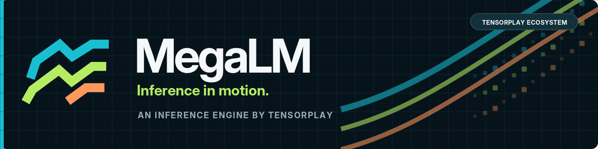
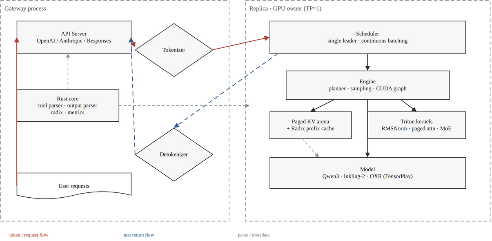
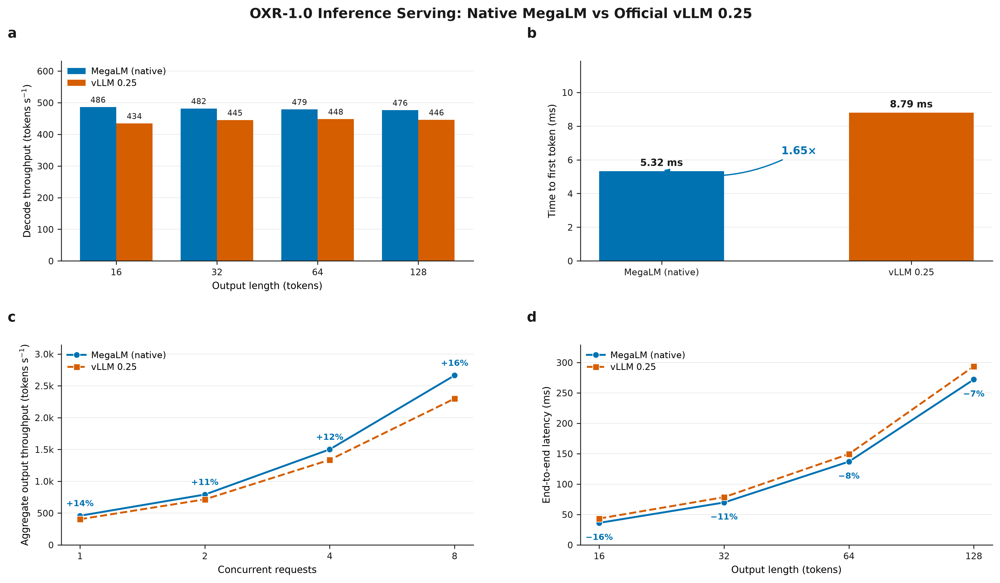
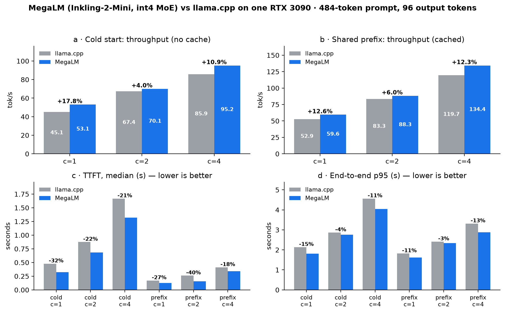
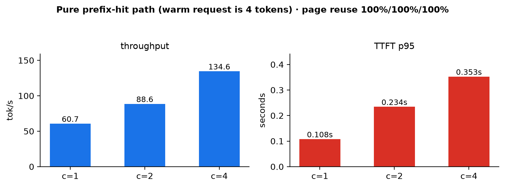

<div align="center">
  

  <p><strong>基于 <a href="https://github.com/lexing-2026/TensorPlay">TensorPlay</a> 构建的高性能大模型推理引擎</strong></p>

  <p>
    <a href="#关于-megalm">关于</a> ·
    <a href="#-动态">动态</a> ·
    <a href="#-基于-tensorplay">技术基石</a> ·
    <a href="#-核心能力">核心能力</a> ·
    <a href="#-快速开始">快速开始</a> ·
    <a href="#-api-端点">API 端点</a> ·
    <a href="#-性能表现">性能表现</a> ·
    <a href="#-文档">文档</a> ·
    <a href="./CONTRIBUTING.md">参与贡献</a>
  </p>
  <p>
    <a href="./README.md"><strong>EN</strong></a> ·
    <a href="./README.zh.md"><strong>中文</strong></a>
  </p>
  <p>
    
    
    
    <a href="https://github.com/ohtensorplay/megalm/stargazers"></a>
    <a href="https://github.com/ohtensorplay/megalm/actions/workflows/lint.yml"></a>
    <a href="https://github.com/ohtensorplay/megalm/actions/workflows/test.yml"></a>
    <a href="./LICENSE"></a>
  </p>
</div>

---

## 📰 动态

- **[2026/11] 原生适配 Nanbeige4.2-3B** — 该模型是 22 层 dense RoPE/GQA 解码器整栈复用 2 次的循环架构（3B 非嵌入参数）。MegaLM 复用 Llama 系列张量热路径与权重加载器，新增循环调度与逐 loop 独立 KV 缓存；权重下载走官方 Hub SDK。\[[模型](https://huggingface.co/Nanbeige/Nanbeige4.2-3B)\] \[[用法](docs/models/nanbeige.md)\]
- **[2026/11] 原生支持 Inkling-2** — MegaLM 现已端到端运行 `thinkingmachines/Inkling-2-Mini`：26.4B 总参数 / 3.4B 激活的循环架构模型，具备 24 层混合 local/global 注意力、48 次 loop 执行，以及 NVFP4/MXFP8 专家权重常驻解码；热路径不依赖 Transformers。\[[模型](https://huggingface.co/thinkingmachines/Inkling-2-Mini)\] \[[官方博客](https://thinkingmachines.ai/news/inkling-2-mini/)\]
- **[2026/11] 原生适配 OXR-1.0 视觉语言模型** — LLM 与视觉塔均在 TensorPlay 热路径执行，支持图像占位符展开与完整的视觉缓存语义。\[[模型](https://huggingface.co/SoMarkAI/OXR-1.0)\] \[[GitHub](https://github.com/SoMarkAI/OXR)\]
- **[2026/11] 正面对比结果** — 单卡 RTX 3090 上，原生 MegaLM 在四个服务场景中领先官方 vLLM 0.25，并在全部 18 个吞吐/延迟点上领先 llama.cpp，贪心输出完全一致。\[[对比 vLLM](docs/benchmarks/oxr_vllm_comparison.png)\] \[[对比 llama.cpp](docs/benchmarks/llamacpp_comparison.png)\]
- **[2026/11] 适配面壁智能 MiniCPM5** — MiniCPM5-1B/2B 通过原生 Llama 系列热路径运行，支持显式声明的解耦 `head_dim`；新增 `minicpm5` 解析器处理该系列的 `<function name=...><param name=...>` XML 工具调用。\[[模型](https://www.modelscope.cn/models/OpenBMB/MiniCPM5-1B)\]
- **[2026/11] 适配面壁智能 MiniCPM4-0.5B** — MiniCPM4 走 `minicpm` 模型家族路径，原生支持 LongRoPE 短/长因子插值、`scale_emb` / `scale_depth` / `dim_model_base` 缩放，并用共享的 embedding/lm_head 权重加载。贪心输出已与官方实现逐 token 对齐。\[[模型](https://www.modelscope.cn/models/OpenBMB/MiniCPM4-0.5B)\]
- **[2026/11] 原生适配 LiquidAI LFM3-1.7B** — 支持 24 层三混合架构（13 个门控短卷积、5 个滑窗注意力、6 个全局注意力）；实现了 QK-RMSNorm、逐头 sigmoid 门控、sandwich norm 与卷积状态管理，并复用 paged KV 缓存。\[[模型](https://huggingface.co/LiquidAI/LFM3-1.7B)\]

---

## 关于 MegaLM

MegaLM 是 **TensorPlay 生态**中的大模型推理与服务引擎，面向 Qwen3 / Qwen3.5 等主流模型，专为低延迟、高吞吐的线上服务场景设计。

如果说 [TensorPlay](https://github.com/lexing-2026/TensorPlay) 提供了张量、算子与内核的底层基石，那么 MegaLM 就是建立在这块基石之上的**推理与服务层**：将 TensorPlay 的张量运行时与内核体系用于大模型推理，提供完整的模型能力、调度策略与服务协议。

- ⚡ **快**：自研融合算子与连续批处理，单请求与高并发场景均具备竞争力。
- 🪶 **轻**：热路径不依赖 Transformers，权重流式装载，启动更轻。
- 🧩 **全**：覆盖主流开源模型、多模态输入、工具调用、结构化输出与可观测性。
- 🔌 **兼容**：OpenAI-compatible API，可直接接入现有生态与客户端。

> 运行环境：Linux · Python ≥ 3.12 · NVIDIA Ampere 及以上 GPU。

---

## 🧱 基于 TensorPlay

MegaLM 与 TensorPlay 是一套自上而下的技术栈：

| 层次 | 项目 | 职责 |
| --- | --- | --- |
| **推理与服务层** | **MegaLM** | 模型执行、连续批处理、KV 缓存、采样、服务网关与协议 |
| **张量与内核基石** | [TensorPlay](https://github.com/lexing-2026/TensorPlay) | 张量运行时、算子分发、内核体系、序列化与设备抽象 |
| **编译后端**（可选） | [tensorplay-tensorrt](https://github.com/lexing-2026/tensorplay-tensorrt) 等 | 为 TensorPlay 提供编译与后端加速能力 |



MegaLM 的计算内核与权重装载均基于 TensorPlay 构建——从张量运算、算子分发到 checkpoint 的序列化读取，整个执行栈共享同一套底层语义。这意味着：

- **一套基石，多种用途**：同一份 TensorPlay 能力既服务于框架学习，也服务于生产推理。
- **端到端可控**：从底层内核到上层服务协议由同一生态贯通，减少异构依赖。
- **可扩展**：TensorPlay 的后端与硬件生态可持续为 MegaLM 带来新的加速可能。

---

## ✨ 核心能力

### 高性能推理
- **连续批处理**：Decode 优先、Chunked Prefill、Prefill/Decode 混合批处理，兼顾首 token 延迟与整体吞吐。
- **智能缓存**：真实 GPU paged KV 与页对齐 Radix 前缀缓存，共享前缀零拷贝复用，显存压力下自动回收冷前缀。
- **分层 KV**：可选的 pinned host 与文件系统层，内容寻址页、异步 DMA、分阶段提升与调度器安全复用。
- **量化 KV 缓存**：对标 vLLM 的 FP8（per-tensor / per-head / 动态 per-token-head）、INT4 与 NVFP4 方案，内嵌 scale、TensorPlay 原生算子、反量化 attention kernel，以及可选的 SM89+ 原生 FP8 attention（见 [`docs/design/kv-cache-quantization.md`](docs/design/kv-cache-quantization.md)）。
- **Weight-only INT4（AWQ / compressed-tensors）**：`pack-quantized` W4A16 checkpoint 直接以 int4 code 与 checkpoint scale 常驻显存，经 TensorPlay 融合反量化 GEMM 执行；`Qwen3-VL-8B-Instruct-AWQ-4bit` 无需 bf16 权重副本即可端到端运行。
- **自研算子**：fused RMSNorm、paged attention、grouped tensor-core MoE、持久化路由等关键路径基于 TensorPlay 手写优化。
- **CUDA Graph**：Decode 阶段 bucket capture/replay，消除内核 launch 开销。
- **多 LoRA**：在 dense generic causal LM 上支持 vLLM 风格的按请求 adapter，BGMV 批式 GEMV 内核、运行时注册与固定 slot 预算（见 [`docs/design/lora.md`](docs/design/lora.md)）。
- **Stax 预填充下沉（可选）**：`--compile-backend stax` 按精确 token bucket 探测 SwiGLU dense-MLP 预填充区域，同形状层共享一份产物，原生 lowering、数值、shape、测速与 CUDA Graph 可捕获全部通过且在启动/显存预算内才启用；attention 投影与视觉塔 MLP 需用 `--compile-regions` 显式开启。当前 TensorPlay 版本上 Stax 与手写融合 kernel 基本持平，默认阈值会拒绝所有区域，decode 保持手写 kernel（见 [`docs/design/compile-backend.md`](docs/design/compile-backend.md)）。

### 广泛模型支持
- 覆盖 **Qwen3 / Qwen3.5**（Dense / MoE）、**Qwen3-VL**、Llama、Mistral、Mixtral、Qwen2、Yi、DeepSeek、Phi3、InternLM、Granite、ERNIE、**MiniCPM4 / MiniCPM5**、**LFM3** 等主流模型。
- 原生支持 **Qwen2.5-Omni** 多模态 Thinker，以及 **Inkling-2** 循环架构模型。

### 完整服务协议
- **OpenAI Chat Completions**：开箱即用的流式推理接口。
- **Anthropic Messages** 与 **OpenAI Responses**：原生协议端点，含 response store 与工具调用事件。
- **Function Calling**：多模型族的增量工具调用解析，流式参数输出。
- **决策模型端点**：`/v1/systemone` 与 `/v1/decisions`，无需专用权重即可将 chat 模型用作决策模型。

### 生产就绪
- **结构化输出**：`json_object` / `json_schema` 引擎级约束解码，保证输出合法 JSON。
- **logprobs**：支持 `logprobs` 与 `top_logprobs`，采样 token 的 top-k 概率由引擎按实际采样分布计算并随 SSE / 非流式响应返回。
- **OpenAI 错误协议**：所有 HTTP 失败统一返回 `{"error": {...}}` 信封，与 OpenAI/vLLM 客户端兼容。
- **PD 分离路由**：可配置 prefill/decode 双上游，透明转发 KV transfer handle，详见 [PD 分离部署](docs/deployment/pd-disaggregation.md)。
- **多模态媒体**：图片、视频、音频输入，远程 URL 抓取具备 SSRF 防护。
- **可观测性**：Prometheus 指标端点、结构化日志、分布式追踪。
- **上下文管理**：自动历史裁剪，保障长对话稳定服务。

---

## 🚀 快速开始

> **平台要求**：Linux + NVIDIA Ampere 及以上 GPU，Python ≥ 3.12。暂不支持其他平台。

### 1. 准备环境

```bash
python3.12 -m venv .venv
source .venv/bin/activate
```

### 2. 安装

```bash
python -m pip install tensorplay
python -m pip install -e .
# 要从 MegaHub / Hugging Face / ModelScope 直接加载仓库 ID，再装 Hub SDK：
python -m pip install -e '.[hub]'
```

> **Docker 方式：** 构建时通过
> `docker build --build-arg PIP_EXTRA_INDEX_URL=https://download.tensorplay.cn/simple -t megalm:local .`
> 指定 TensorPlay 软件源，运行时用
> `docker run --gpus all -p 8000:8000 -v /path/to/models:/models:ro megalm:local /models/<model> --host 0.0.0.0`。
> 详见 [Docker 部署](docs/deployment/docker.md)。

### 3. 离线推理

```bash
python -m megalm \
  --model <your-model> \
  --prompt "你好，请用一句话介绍你自己。" \
  --max-new-tokens 16

# 也可以直接给 Hub 仓库 ID（官方 SDK 下载，结果落到本地 checkpoint 目录）
python -m megalm --model Qwen/Qwen3-8B --source hf --prompt "你好"
# mega://models/<ns>/<repo>、hf:<ns>/<repo>、ms:<ns>/<repo> 同样可用
```

详见 [模型来源：MegaHub / Hugging Face / ModelScope](docs/getting_started/model-sources.md)。

### 4. 启动 API 服务

```bash
megalm-server --model <your-model> \
  --served-model-name <model-name> \
  --host 127.0.0.1 \
  --port 8000
```

### 5. 验证并发送请求

确认服务就绪：

```bash
curl http://127.0.0.1:8000/health
# {"status":"ok"}
```

发送 Chat Completions 请求（`model` 需与 `--served-model-name` 一致）：

```bash
curl http://127.0.0.1:8000/v1/chat/completions \
  -H "Content-Type: application/json" \
  -d '{
    "model": "<model-name>",
    "messages": [{"role": "user", "content": "你好，请用一句话介绍你自己。"}],
    "max_tokens": 128,
    "stream": false
  }'
```

设置 `"stream": true` 即以 Server-Sent Events 流式返回。模型与运行时信息见 `/v1/models`、`/api/inference/status`，Prometheus 指标见 `/metrics`。

---

## 🔌 API 端点

| 端点 | 说明 |
| --- | --- |
| `POST /v1/chat/completions` | OpenAI 风格 Chat，支持流式、工具调用与结构化输出 |
| `POST /v1/completions` | OpenAI 风格文本补全 |
| `POST /v1/messages` | Anthropic Messages API（另含 `/v1/messages/count_tokens`） |
| `POST /v1/responses` | OpenAI Responses API，内置 response store |
| `POST /v1/systemone` | TypeSafe 决策问题 |
| `POST /v1/decisions` | SGLang 风格决策问题 |
| `POST /v1/load_lora_adapter` | 运行时注册 PEFT LoRA adapter |
| `POST /v1/unload_lora_adapter` | 卸载 LoRA adapter |
| `GET /v1/models` | 可用模型信息 |
| `GET /health` | 服务健康检查 |
| `GET /metrics` | Prometheus 指标 |

---

## 📊 性能表现

### 原生 MegaLM vs 官方 vLLM 0.25

测试配置：

- 硬件：1 × RTX 3090（BF16）
- 模型：OXR-1.0（视觉语言）
- 输入：固定的图像 + prompt
- 基线：官方 vLLM 0.25
- 负载：输出长度 16 / 32 / 64 / 128 下的 Decode 吞吐与端到端延迟；首 token 延迟；并发 1 / 2 / 4 / 8 下的聚合吞吐



完整配置见 [`docs/benchmarks/oxr_vllm_comparison.pdf`](docs/benchmarks/oxr_vllm_comparison.pdf)。

### MegaLM vs llama.cpp — 同卡、同 GGUF、同启动参数

单卡 RTX 3090 上的一次交错测量：llama.cpp 在 MegaLM 前后各测一次，用来夹住 GPU 降频漂移；每个测量点是预热时钟后 5 次试验的中位数。同样的 484 token prompt、96 个贪心输出 token，`--parallel 4` / `--max-num-seqs 4`。



**吞吐 — tok/s（越高越好）**

| 场景 | 并发 1 | 并发 2 | 并发 4 |
| --- | --- | --- | --- |
| 冷启动（无缓存） | 45.1 → **53.1**（+17.8%） | 67.4 → **70.1**（+4.0%） | 85.9 → **95.2**（+10.9%） |
| 共享前缀（命中缓存） | 52.9 → **59.6**（+12.6%） | 83.3 → **88.3**（+6.0%） | 119.7 → **134.4**（+12.3%） |

**延迟 — 秒（越低越好）**

| 指标 | 场景 | 并发 1 | 并发 2 | 并发 4 |
| --- | --- | --- | --- | --- |
| TTFT 中位数 | 冷启动 | 0.479 → **0.325**（−32%） | 0.875 → **0.684**（−22%） | 1.668 → **1.321**（−21%） |
| TTFT 中位数 | 共享前缀 | 0.171 → **0.125**（−27%） | 0.261 → **0.157**（−40%） | 0.412 → **0.340**（−18%） |
| E2E p95 | 冷启动 | 2.13 → **1.81**（−15%） | 2.86 → **2.76**（−4%） | 4.56 → **4.05**（−11%） |
| E2E p95 | 共享前缀 | 1.82 → **1.62**（−11%） | 2.41 → **2.34**（−3%） | 3.31 → **2.88**（−13%） |

18 个测量点全部为 MegaLM 占优。最窄的是冷启动并发 2：两个 prompt 各 484 token，512 token 的步预算一次只放得下一个 prompt，两个 prefill 无法同批——llama.cpp 处境相同，剩下的差距在每步固定开销而非缓存。



纯命中路径（预热请求只有 4 token，不是 484 token 的完整 prefill）下，并发 1 / 2 / 4 的吞吐为 60.7 / 88.6 / 134.6 tok/s，TTFT p95 为 0.108 / 0.234 / 0.353 s，可复用页面 100% 命中。

<details>
<summary><b>测试条件与说明</b></summary>

- 模型：Inkling-2-Mini（int4 MoE，128 专家、top-8、24 层 × 2 pass），1 × RTX 3090。llama.cpp：`-c 4096 --parallel 4 --flash-attn on`，贪心（`temperature 0`、`ignore_eos`）。MegaLM：`--dtype bfloat16 --max-model-len 4096 --max-cache-tokens 4096 --max-num-seqs 4 --max-num-batched-tokens 512 --prefill-chunk-size 512 --mixed-prefill-chunk-size 512 --cuda-graph-batches 1,2,4 --replica-mode process`。冷启动数据来自真正以 `--no-prefix-cache` 启动的服务，而不是"缓存能力开着但恰好未命中"的服务。
- 前缀复用是**实测**而非假设：llama.cpp 报告 96.9% 的 prompt token 命中缓存（`timings.cache_n`）；MegaLM 由引擎计数器报告 95.9%（464/484）——1 个百分点差异来自页粒度：MegaLM 只发布完整的 16-token 页，llama.cpp 可复用末尾不满一页的部分。
- 贪心输出在"完整 prefill"与"缓存命中"之间逐 token 一致：恢复的短卷积状态产出完全相同的 token（`parity miss==hit`），而不只是相近的分布。
- 以上为单卡单次测量，只描述这组参数和这个负载，不应视为通用结论。图表直接由该次运行的 JSON 产物渲染，测量脚本与该产物一并保留。

</details>

---

## 📚 文档

- [文档索引](docs/README.md)：快速开始、设计文档、模型适配、基准。
- [架构](docs/design/architecture.md) · [调度器](docs/design/scheduler.md) · [KV Cache](docs/design/kv-cache.md) · [ExecutionPlan](docs/design/execution-plan.md)
- [多 LoRA](docs/design/lora.md) · [结构化输出](docs/design/structured-output.md) · [可观测性](docs/design/observability.md)
- [基准](docs/benchmarks/README.md)：[对比 vLLM](docs/benchmarks/oxr-vllm.md) · [对比 llama.cpp](docs/benchmarks/llamacpp.md)
- [TensorPlay 官方网站](https://tensorplay.cn) · [TensorPlay 源码](https://github.com/lexing-2026/TensorPlay) · [社区论坛](https://forum.tensorplay.org)
- [MEGA Hub](https://mega.tensorplay.cn) · [ohtensorplay 组织](https://github.com/ohtensorplay)

---

## 参与贡献与许可

- [贡献指南](CONTRIBUTING.md)：开发环境、检查项与 PR 流程。
- [行为准则](CODE_OF_CONDUCT.md) · [安全策略](SECURITY.md) · [变更记录](CHANGELOG.md)
- MegaLM 采用 [Apache License 2.0](LICENSE) 发布。

---

<div align="center">
  <p>MegaLM 是 TensorPlay 生态的一部分。如果对你有帮助，欢迎 Star 与反馈。</p>
</div>
