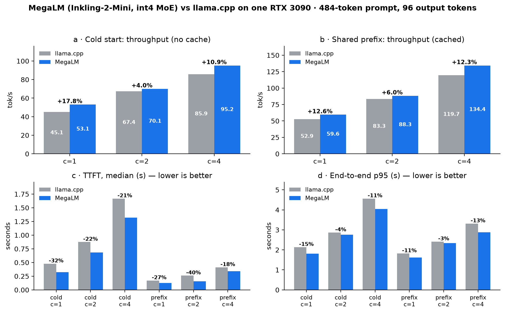
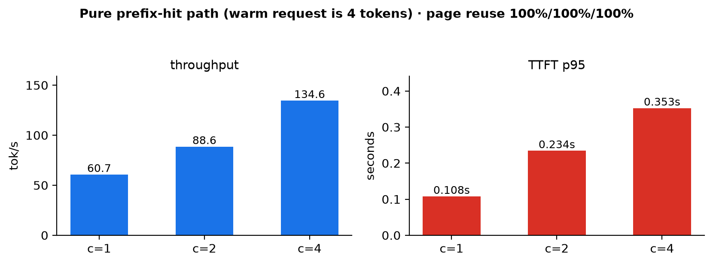

# MegaLM vs llama.cpp

同一单卡 RTX 3090、同一 GGUF、同一启动参数。llama.cpp 在 MegaLM 前后各测一次以夹住时钟漂移；每点为预热时钟上 5 次实测的中位数。484-token prompt、96 个贪心输出 token、`--parallel 4` / `--max-num-seqs 4`。

吞吐 tok/s（越高越好）：

| 场景 | c=1 | c=2 | c=4 |
| --- | --- | --- | --- |
| 冷启动（无缓存） | 45.1 → **53.1** (+17.8%) | 67.4 → **70.1** (+4.0%) | 85.9 → **95.2** (+10.9%) |
| 共享前缀（命中） | 52.9 → **59.6** (+12.6%) | 83.3 → **88.3** (+6.0%) | 119.7 → **134.4** (+12.3%) |

延迟 秒（越低越好）：

| 指标 | 场景 | c=1 | c=2 | c=4 |
| --- | --- | --- | --- | --- |
| TTFT 中位 | 冷 | 0.479 → **0.325** (−32%) | 0.875 → **0.684** (−22%) | 1.668 → **1.321** (−21%) |
| TTFT 中位 | 共享前缀 | 0.171 → **0.125** (−27%) | 0.261 → **0.157** (−40%) | 0.412 → **0.340** (−18%) |
| E2E p95 | 冷 | 2.13 → **1.81** (−15%) | 2.86 → **2.76** (−4%) | 4.56 → **4.05** (−11%) |
| E2E p95 | 共享前缀 | 1.82 → **1.62** (−11%) | 2.41 → **2.34** (−3%) | 3.31 → **2.88** (−13%) |

18 个点全部偏向 MegaLM。最窄的是冷 c=2：两个 prompt 都是 484 token，512-token step budget 每步只容纳一个 prefill，两个 prefill 无法共调度；llama.cpp 同理，剩余差距是每步开销而非缓存。

纯命中请求（warm 请求 4 token，不是 484-token prefill）在 c = 1 / 2 / 4 下维持 60.7 / 88.6 / 134.6 tok/s，TTFT p95 为 0.108 / 0.234 / 0.353 s，复用 100% 可用页。

## 测试设置

- 模型：Inkling-2-Mini（int4 MoE，128 experts，top-8，24 层 × 2 passes），1 × RTX 3090。
- llama.cpp：`-c 4096 --parallel 4 --flash-attn on`，贪心（`temperature 0`、`ignore_eos`）。
- MegaLM：`--dtype bfloat16 --max-model-len 4096 --max-cache-tokens 4096 --max-num-seqs 4 --max-num-batched-tokens 512 --prefill-chunk-size 512 --mixed-prefill-chunk-size 512 --cuda-graph-batches 1,2,4 --replica-mode process`。冷启动点来自以 `--no-prefix-cache` 启动的服务，不是带缓存但恰好 miss 的服务。
- 前缀复用是测出来的：llama.cpp 报 96.9% prompt token 命中（`timings.cache_n`），MegaLM 报 95.9%（464/484）。1 个百分点来自页粒度：MegaLM 只发布完整 16-token 页，llama.cpp 可复用不完整的尾页。
- 贪心输出在完整 prefill 与缓存命中之间逐 token 相同；短卷积状态恢复后 `parity miss==hit`，不只是分布相近。
- 数字来自单卡单次实测，描述的是上述参数与负载，不是通用结论。图表直接由该次运行的 JSON 产物渲染。
