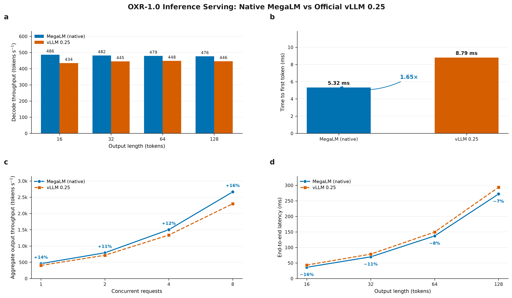

# OXR-1.0：MegaLM vs vLLM

配置：

- 硬件：1 × RTX 3090（BF16）
- 模型：OXR-1.0（视觉语言）
- 输入：固定图片 + prompt
- 基线：vLLM 0.25
- 负载：输出长度 16 / 32 / 64 / 128 的 decode 吞吐与端到端延迟；TTFT；1 / 2 / 4 / 8 并发的聚合吞吐

完整配置见 [oxr_vllm_comparison.pdf](oxr_vllm_comparison.pdf)。图表由 [make_oxr_comparison_chart.py](make_oxr_comparison_chart.py) 从原始 JSON 生成。
